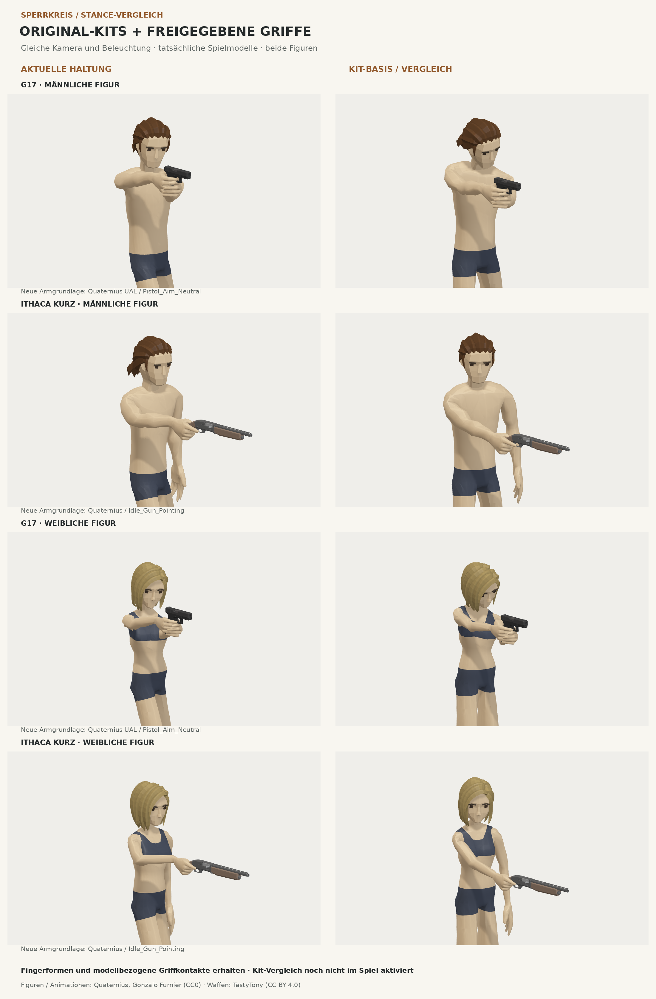

# Waffenhaltungen aus vorhandenen Kits — Vergleich, noch kein Laufzeitwechsel

Der abgesägte Ithaca-Arm wird durch die bisherigen Ziel-/Ellenbogen-/
Handgelenkvorgaben unnötig stark gebogen. Der neue Auftrag ersetzt diese
Grundhaltungen durch vorhandene Kits und erhält die finalisierten Finger-/
Griffprofile. Dieser Entwurf enthält den geprüften statischen Vergleich für
G17 und kurze Ithaca auf beiden Originalfiguren. Der Spielcontroller ist
unverändert; der vollständige Wechsel bleibt offen.



## Geprüfter Teil

| Waffe | Neue Basis | Ellenbogen männlich, vorher → Kit | Weiblich, vorher → Kit |
|---|---|---:|---:|
| G17 | Quaternius UAL `Pistol_Aim_Neutral` | 27,8° → 14,3° | 27,8° → 14,3° |
| Ithaca kurz | Quaternius `Idle_Gun_Pointing` | 53,2° → 24,7° | 68,7° → 25,9° |

Die Werte messen den Winkel zwischen Ober- und Unterarm. Der ergänzende Winkel
zwischen Unterarm und Mittelhand sinkt bei der kurzen Ithaca von 34,1°/44,1°
auf 7,1°/7,5°. Das ist eine geometrische Diagnose, keine anatomische Messung.
Die vollständigen Messwerte stehen in [stance-kit-measurements.json](review/stance-kit-measurements.json).

Die Kandidaten verwenden die tatsächlichen geglätteten Spielkörper und die
eingebauten Waffenmodelle. Die Hand-/Fingerquaternionen stammen unverändert
aus `g17-grasp.json` bzw. `ithaca-one-hand.json`. Eine starre Ausrichtung des
gesamten Waffenarms erhält die importierte Ellenbogen-/Handgelenkform. Der
Kontaktfit betrifft die Stützhand sowie begrenzte Unterschiede der Reichweite.

`tests/stance-kit.test.mjs` prüft beide Figuren: identische freigegebene
Fingerrotationen, echte Hand-/Waffenkontakte, unveränderte Beinrotationen und
Weltpunkte, keine Armdurchdringung der verformten Körperdreiecke in der geprüften
Zielpose sowie die tatsächliche Laufachse. Ein Importgraphtest hält das noch
nicht integrierte Modul aus dem Player-Laufzeitpfad heraus. Die Zusicherung gilt
für diese Zielpose, nicht für vollständige Bewegungs- oder Nachladezyklen.

## Quellen und Reproduktion

- Quaternius / Gonzalo Furnier, Universal Animation Library Standard, CC0:
  https://quaternius.itch.io/universal-animation-library.
- Quaternius Ultimate Modular Characters, vorhandene Originalclips, CC0:
  https://quaternius.com/packs/ultimatemodularcharacters.html.
- Zusätzlich vorbereitete, noch nicht freigegebene Langwaffen-/Revolverclips:
  ZenXChaos, ThirdPersonShooter-AnimationSets, Unlicense:
  https://github.com/ZenXChaos/ThirdPersonShooter-AnimationSets.

Die jeweiligen Originaldatei-Hashes stehen in `assets/quaternius/stance-kit.json`.
Die vorhandenen Lizenztexte im selben Ordner gelten weiter. Das Aufbereitungsskript
überträgt ausschließlich Oberkörperknochen, keine Finger oder Beine. Die
Handgelenkdrehung wird relativ zum bereits übertragenen Unterarm abgebildet;
ein direktes Kopieren der globalen Handrotation mischt die Achsen beider Rigs.

```sh
node scripts/prepare-stance-kit.mjs /path/to/UAL1_Standard.glb /path/to/fbx-samples
node scripts/preview-stance-kit.mjs /tmp/sperrkreis-kit-review
node --test tests/stance-kit.test.mjs
```

Der Export liefert acht tatsächliche verformte Dreiecksoberflächen einschließlich
Farben/Normalen und Messwerten. Das Vergleichsbild verwendet dieselbe Kamera und
Beleuchtung je Vorher-/Nachher-Paar. Es ist kein generiertes Ersatzmodell.

## Offener Teil des Auftrags

Die erprobten direkten Controllerwechsel sind nicht übernommen. Ihre Ablaufprüfungen
haben unter anderem Arm-/Rollsprünge nach Nachladeabbruch, unvollständige Rückkehr
bei schnellen Haltungswechseln sowie verfehlte Patronen-/Magazinkontakte gezeigt.
Ein bestandener statischer Griffvergleich deckt diese Fälle nicht ab.

Für die Übernahme müssen die Kit-Grundposen mit den tatsächlich zuletzt erreichten
Handrahmen verbunden werden. Nachladen, Pumpen, Auswurf, Munition und die
freigegebenen Finger bleiben dabei erhalten. Vor einem vollständigen Wechsel sind
die bestehenden Tests für Pistolen, Langwaffen, Flinten, Kollisionsfreiheit und
Nachladeabbruch auf beiden Figuren sowie die Werkstattprüfung erneut zu bestehen.
Die vorbereiteten Langwaffen-/Revolverretargets sind dafür Ausgangsdaten, kein
Nachweis fertiger Waffenhaltungen. Es gibt keine Veröffentlichung dieses Umstiegs.
